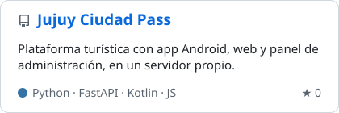
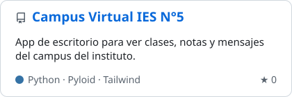
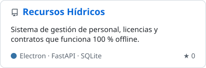
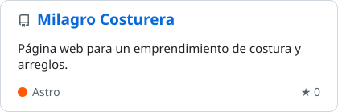
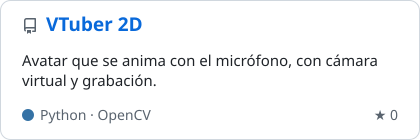
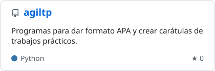

---

### 🧑‍💻 Sobre mí

- 🎓 Estudio la **Tecnicatura Superior en Soporte de Infraestructura de TI** en el IES N°5 "José Eugenio Tello" (Jujuy).
- 🛠️ Hago soporte técnico: mantenimiento y reparación de PCs, redes, routers y asistencia remota.
- 🐍 Programo sobre todo en **Python** (FastAPI, automatización, apps de escritorio) y hago **páginas web**.
- 📱 Últimamente también hago **apps Android** en Kotlin.
- 🌱 Me gusta automatizar todo lo que se repite.
- 💬 Hablo español (nativo) e inglés (intermedio).

 

### 🚀 Proyectos destacados

  
  
  
  
  
  

  🌐 Páginas en línea:
  <a href="https://ulises47123.github.io/campus-ies5-presentacion/">Campus IES N°5</a> ·
  <a href="https://ulises47123.github.io/Milagro-Costurera-y-Arreglo/">Milagro Costurera</a> ·
  <a href="https://ulises47123.github.io/mi-pagina/">Mi página de inicio</a> ·
  <a href="https://ulises47123.github.io/portafolio-v2/">Portafolio</a>

### 🧰 Tecnologías y herramientas

  <picture>
    <source media="(prefers-color-scheme: dark)" srcset="https://skillicons.dev/icons?i=py%2Cfastapi%2Cjs%2Chtml%2Ccss%2Ctailwind%2Castro%2Celectron%2Ckotlin%2Candroidstudio%2Csqlite%2Cmysql&theme=dark&perline=12" />
    
  </picture>
    
  <picture>
    <source media="(prefers-color-scheme: dark)" srcset="https://skillicons.dev/icons?i=git%2Cgithub%2Clinux%2Cdebian%2Cwindows%2Cbash%2Cpowershell%2Cdocker%2Caws%2Cruby%2Carduino%2Cgodot%2Cblender%2Cgimp&theme=dark&perline=14" />
    
  </picture>

### 📊 Estadísticas

  
  

  <picture>
    <source media="(prefers-color-scheme: dark)" srcset="https://streak-stats.demolab.com/?user=ulises47123&locale=es&theme=github-dark-blue&hide_border=true" />
    
  </picture>

  
☕ ¿Te sirvió algo de lo que hago? Podés apoyarme

   
  
  

 

  <picture>
    <source media="(prefers-color-scheme: dark)" srcset="https://raw.githubusercontent.com/ulises47123/mod/main/snake-dark.svg" />
    
  </picture>

