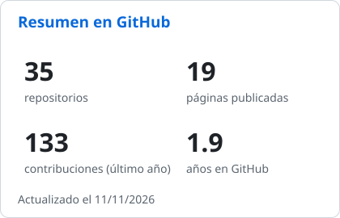
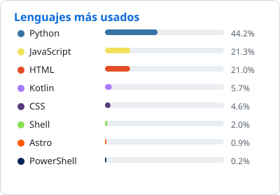

<h1>Hola, soy Ulises Julián 👋</h1>

### 🧑‍💻 Sobre mí

- 🎓 Estudio la **Tecnicatura Superior en Soporte de Infraestructura de TI** en el IES N°5 "José Eugenio Tello" (Jujuy).
- 🛠️ Hago soporte técnico: mantenimiento y reparación de PCs, redes, routers y asistencia remota.
- 🐍 Programo sobre todo en **Python** (FastAPI, automatización, apps de escritorio) y hago **páginas web**.
- 📱 Últimamente también hago **apps Android** en Kotlin.
- 🌱 Me gusta automatizar todo lo que se repite.

 

### 🚀 Proyectos destacados

| Proyecto | De qué se trata | Hecho con |
|---|---|---|
| 🏙️ [**Jujuy Ciudad Pass**](https://github.com/ulises47123/jujuy-ciudad-pass) | Plataforma turística con app Android, web y panel de administración, desplegada en un servidor propio. | Python · FastAPI · Kotlin · JS |
| 🎓 [**Campus Virtual IES N°5**](https://github.com/ulises47123/proyecto-ies-5-launcher) | App de escritorio para ver clases, notas y mensajes del campus del instituto. · [Página](https://ulises47123.github.io/campus-ies5-presentacion/) | Python · Pyloid · Tailwind |
| 🌊 [**Recursos Hídricos**](https://github.com/ulises47123/Recurso-Hidricos) | Sistema de gestión de personal, licencias y contratos, 100 % offline. | Electron · FastAPI · SQLite |
| 🧵 [**Milagro Costurera**](https://github.com/ulises47123/Milagro-Costurera-y-Arreglo) | Página web para un emprendimiento de costura y arreglos. · [Ver sitio](https://ulises47123.github.io/Milagro-Costurera-y-Arreglo/) | Astro |
| 🎙️ [**VTuber 2D**](https://github.com/ulises47123/VTuber) | Avatar que se anima con el micrófono, con cámara virtual y grabación. | Python · OpenCV |
| 📝 [**agiltp**](https://github.com/ulises47123/agiltp) | Programas para dar formato APA y crear carátulas de trabajos prácticos. | Python |

### 🧰 Tecnologías y herramientas

  <picture>
    <source media="(prefers-color-scheme: dark)" srcset="https://skillicons.dev/icons?i=py,fastapi,js,html,css,tailwind,astro,electron,kotlin,androidstudio,sqlite,mysql&theme=dark&perline=12" />
    
  </picture>
   
  <picture>
    <source media="(prefers-color-scheme: dark)" srcset="https://skillicons.dev/icons?i=git,github,linux,debian,windows,bash,powershell,docker,aws,ruby,arduino,godot,blender,gimp&theme=dark&perline=14" />
    
  </picture>

### 📊 Estadísticas

  
  
    
  <picture>
    <source media="(prefers-color-scheme: dark)" srcset="https://streak-stats.demolab.com/?user=ulises47123&locale=es&theme=github-dark-blue&hide_border=true" />
    
  </picture>

### 📫 Contacto

  
  
  
  
  

 

  <picture>
    <source media="(prefers-color-scheme: dark)" srcset="https://raw.githubusercontent.com/ulises47123/mod/main/snake-dark.svg" />
    
  </picture>

